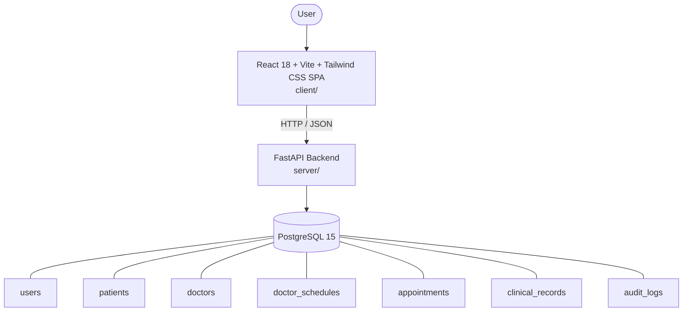

# Architecture

_Auto-generated by the SDLC Assistant from the generated codebase and the approved Feature Spec (latest: SCRUM-458). Regenerated on each push._

## System Diagram

## Tech Stack
- **language**: Python 3.11
- **backend_framework**: FastAPI
- **orm**: SQLAlchemy 2.x
- **database**: PostgreSQL 15
- **frontend**: React 18 + Vite + Tailwind CSS SPA
- **cloud_provider**: Google Cloud Platform (Cloud Run, Cloud SQL)
- **constitution_section_4_followed**: True

## Backend Modules (server/)
- server/__init__.py
- server/config.py
- server/database.py
- server/main.py
- server/models/__init__.py
- server/models/appointment.py
- server/models/audit_log.py
- server/models/clinical_record.py
- server/models/doctor.py
- server/models/patient.py
- server/models/user.py
- server/routes/__init__.py
- server/routes/appointment.py
- server/routes/auth.py
- server/routes/clinical_record.py
- server/routes/doctor.py
- server/routes/patient.py
- server/schemas/__init__.py
- server/schemas/appointment.py
- server/schemas/auth.py
- server/schemas/clinical_record.py
- server/schemas/doctor.py
- server/schemas/patient.py
- server/services/__init__.py
- server/services/appointment_service.py
- server/services/audit_service.py
- server/services/auth_service.py
- server/services/clinical_service.py
- server/services/doctor_service.py
- server/services/patient_service.py
- server/tests/__init__.py
- server/tests/conftest.py
- server/tests/test_appointments.py
- server/tests/test_auth.py
- server/tests/test_clinical_records.py
- server/tests/test_doctors.py
- server/tests/test_patients.py

## Frontend Modules (client/)
- client/eslint.config.js
- client/postcss.config.js
- client/src/App.jsx
- client/src/components/StatusBadge.jsx
- client/src/components/appointments/AppointmentTable.jsx
- client/src/components/appointments/SlotPickerGrid.jsx
- client/src/components/common/AppShell.jsx
- client/src/components/common/KPICard.jsx
- client/src/components/common/StatusBadge.jsx
- client/src/components/consultations/PrescriptionTable.jsx
- client/src/components/consultations/VitalsCard.jsx
- client/src/components/doctors/DoctorRosterList.jsx
- client/src/components/doctors/ScheduleConfigurator.jsx
- client/src/components/patients/PatientRegistrationModal.jsx
- client/src/components/patients/PatientTable.jsx
- client/src/main.jsx
- client/src/pages/AppointmentsPage.jsx
- client/src/pages/ConsultationsPage.jsx
- client/src/pages/DashboardPage.jsx
- client/src/pages/DoctorsPage.jsx
- client/src/pages/PatientsPage.jsx
- client/src/services/api.js
- client/src/setup.js
- client/src/tests/App.test.jsx
- client/src/tests/Appointments.test.jsx
- client/src/tests/Consultations.test.jsx
- client/src/tests/Dashboard.test.jsx
- client/src/tests/Doctors.test.jsx
- client/src/tests/Patients.test.jsx
- client/tailwind.config.js
- client/vite.config.js

## API Endpoints
- POST /api/v1/auth/login
- POST /api/v1/patients
- GET /api/v1/patients
- GET /api/v1/patients/{id}
- PUT /api/v1/patients/{id}
- GET /api/v1/doctors
- GET /api/v1/doctors/{id}/availability
- POST /api/v1/doctors/{id}/schedules
- POST /api/v1/appointments
- GET /api/v1/appointments
- PATCH /api/v1/appointments/{id}/status
- POST /api/v1/appointments/{id}/records
- GET /api/v1/appointments/{id}/records

## Data Model
- users
- patients
- doctors
- doctor_schedules
- appointments
- clinical_records
- audit_logs
