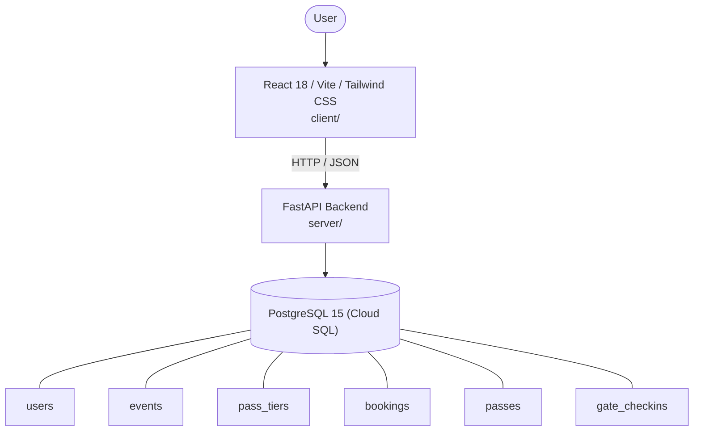

# Architecture

_Auto-generated by the SDLC Assistant from the generated codebase and the approved Feature Spec (latest: SCRUM-459). Regenerated on each push._

## System Diagram

## Tech Stack
- **language**: Java 17
- **backend_framework**: Spring Boot 3.x
- **orm**: Spring Data JPA / Hibernate
- **database**: PostgreSQL 15 (Cloud SQL)
- **frontend**: React 18 / Vite / Tailwind CSS
- **cloud_provider**: GCP (Google Cloud Run + Cloud SQL + Cloud CDN)
- **constitution_section_4_followed**: True

## Backend Modules (server/)
- server/__init__.py
- server/config.py
- server/database.py
- server/dependencies.py
- server/main.py
- server/models.py
- server/routers/__init__.py
- server/routers/admin.py
- server/routers/auth.py
- server/routers/bookings.py
- server/routers/events.py
- server/routers/gates.py
- server/routers/passes.py
- server/schemas.py
- server/security.py
- server/tests/__init__.py
- server/tests/conftest.py
- server/tests/test_admin.py
- server/tests/test_auth.py
- server/tests/test_bookings.py
- server/tests/test_events.py
- server/tests/test_gates.py
- server/tests/test_passes.py

## Frontend Modules (client/)
- client/eslint.config.js
- client/postcss.config.js
- client/src/App.jsx
- client/src/components/AnalyticsDashboard.jsx
- client/src/components/CheckoutPage.jsx
- client/src/components/CurrencySelector.jsx
- client/src/components/Navbar.jsx
- client/src/components/RefundPortal.jsx
- client/src/components/StatusBadge.jsx
- client/src/components/WebhookLogViewer.jsx
- client/src/main.jsx
- client/src/pages/AnalyticsPage.jsx
- client/src/pages/CheckoutPage.jsx
- client/src/pages/RefundPortalPage.jsx
- client/src/services/api.js
- client/src/setup.js
- client/src/tests/AnalyticsDashboard.test.jsx
- client/src/tests/CheckoutPage.test.jsx
- client/src/tests/RefundPortal.test.jsx
- client/tailwind.config.js
- client/vite.config.js

## API Endpoints
- POST /api/v1/auth/register
- POST /api/v1/auth/login
- GET /api/v1/events
- GET /api/v1/events/{id}/tiers
- POST /api/v1/bookings
- GET /api/v1/passes/{passId}
- POST /api/v1/gates/validate
- GET /api/v1/admin/analytics/live
- PUT /api/v1/admin/pass-tiers/{id}
- GET /api/v1/admin/attendees/export

## Data Model
- users
- events
- pass_tiers
- bookings
- passes
- gate_checkins
